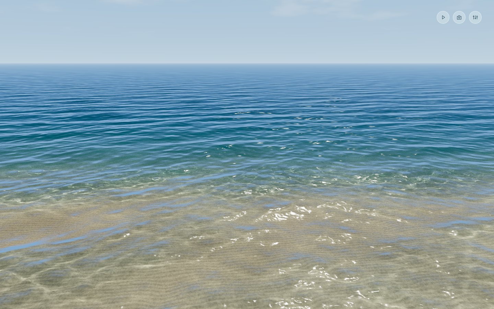

# PELAGIC · Three.js 海面实验室

参考清澈浅海照片制作的可交互场景：远处蓝色海面、近岸透光的沙底、波峰反光和随波浪移动的焦散。界面与所有渲染均实时生成，没有使用参考照片作为背景。



## 运行

双击 `start.cmd`，然后访问 **http://127.0.0.1:4173**。

也可以在本目录运行：

```powershell
node server.mjs
```

需要支持 WebGL 2 的 Chrome / Edge，以及 Node.js。Three.js r180 已保存在 `vendor/`，无需安装依赖，运行时无需联网。ES 模块需要 HTTP 服务，请勿直接双击 `index.html`。

## 操作

- 拖动旋转、滚轮缩放；移动端可单指旋转、双指缩放。
- 底部选择 **海面 / 浅水焦散 / 俯瞰**，视角平滑过渡。
- 右侧调整波浪、流动速度、近岸水深、清澈度、焦散强度、太阳高度。
- **清澈浅海 / 海风起伏 / 落日余晖** 是三个海况与光照预设。
- **空格**暂停/播放，暂停时仍可转动镜头、调整参数。
- **H** 切换沉浸模式；右上角滑杆按钮只切换参数面板。
- 相机按钮保存不含界面的 PNG；**重置**恢复默认海况与观察位置。
- 画质支持精细、均衡、轻量；移动端默认收起控制面板。

## 渲染构成

1. **三维波面**：96 个具有随机相位、频率、振幅和方向的波谱分量，分为有主风向的涌浪与方向更分散的细波。连续谱噪声扰动相位；Gerstner 式横向位移把几何顶点向浪峰挤压，形成较窄的峰顶和较宽的浪谷。法线由位移后的两个切向量叉乘计算。GPU 每帧输出高度、梯度、水平位移及其 Jacobian，统一供水面、反射、折射和焦散使用。几何采样按实际网格间距过滤，减少远处的三角形尖刺。
2. **水面光学**：Fresnel 反射、Snell 折射（折射率 1.333）、与光程相关的分通道吸收、天空倒影和 GGX 太阳高光。较窄的 GGX 高光瓣形成细碎闪光，并按像素法线变化作抗闪烁过滤；太阳高光与浪尖泡沫分别计算。
3. **沙底**：倾斜的浅海地形和轻微沙丘，程序化细砂、斑点、沙纹；观察射线折射后与沙底求交，因此视角改变时沙底会产生折射位移。
4. **动态焦散**：使用同一波场的水面位置与法线折射太阳光，将其投射到沙底。在独立的半浮点渲染目标中，结合投射前后实际面积比与平滑采样的映射 Jacobian 估算光通量密度；重叠光线以加法混合汇聚。错列采样网格和带宽过滤减少方块与三角形痕迹。水面材质在折射后的沙底位置读取光照图。
5. **焦散范围自适应**：两层光照图根据相机视锥、距离、画面比例与像素覆盖范围自动调整中心和尺寸。近层保留前景细节，远层补足拉远后的覆盖，重叠区域平滑混合。采样使用世界坐标，缩放不会直接拉伸焦散纹理；光线源网格为太阳折射留出边界余量。远处小于像素的细节通过 mipmap 和渐变回到平均照明。
6. **实时控制**：太阳角度、时间、波浪和水深同时传给水面及焦散着色器。
7. **浪尖白沫**：以水平位移 Jacobian 的压缩程度和浪峰位置作为遮罩，叠加多尺度 Simplex 噪声打散。高强度时局部出现，日光闪点不依赖白沫开关。

这是面向实时视觉的解析近似，不是完整的流体或光谱海洋求解器。当前没有岸边破碎浪、岸线拍岸、物体遮挡、真实多次散射或水下相机。焦散覆盖随相机变化，极远处退化为平均照明；相机保持在水面上方。颜色与高光经过艺术调整，以接近参考照片的浅海观感。

## 算法参考与实现边界

- 已借鉴 [NVIDIA GPU Gems：Effective Water Simulation from Physical Models](https://developer.nvidia.com/gpugems/gpugems/part-i-natural-effects/chapter-1-effective-water-simulation-physical-models) 中的多方向波、几何与细波分层以及 Gerstner 横向挤压思想。这里自行实现，保留了随机相位扰动。
- 高光使用 [Walter 等：Microfacet Models for Refraction through Rough Surfaces](https://www.cs.cornell.edu/~srm/publications/EGSR07-btdf.pdf) 中的 GGX 分布与微表面模型，配合 Smith 遮蔽项和像素覆盖范围过滤。
- [Tessendorf：Simulating Ocean Water](https://jtessen.people.clemson.edu/reports/papers_files/coursenotes2002.pdf) 的随机海洋谱与 FFT 是更完整的扩展方向。**当前版本没有实现 FFT，也没有把手工调节的频谱称为 Phillips 或 JONSWAP 海况模型。**
- 水面颜色、太阳辐照强度与近岸地形仍为演示参数，未按真实拍摄地点、水质、风速及相机曝光标定。

## 文件

| 文件 | 用途 |
| --- | --- |
| `index.html` / `src/style.css` | 中文界面与响应式布局 |
| `src/main.js` | 场景、光照图、摄像机、参数与交互 |
| `src/shaders.js` | 波场、水面、天空、焦散 GLSL |
| `src/wave-spectrum.js` | 随机波谱、连续扰动与 GPU 波场预计算 |
| `src/caustics.js` | 跟随相机的近远两层焦散覆盖与采样密度 |
| `vendor/` | 固定版本 Three.js 和 OrbitControls，附 MIT 许可证 |
| `server.mjs` | 仅监听 127.0.0.1 的本地静态服务 |
| `output/` | 浏览器实拍截图与检查报告 |

## 检查

运行演示无需安装依赖。语法检查使用 `npm run check`。

需要复跑浏览器检查时，先启动本地服务，再在另一个终端执行：

```sh
npm install --no-save --package-lock=false playwright
npx playwright install chromium
npm run test:browser
npm run test:zoom
```

检查截图和报告写入 `output/`，不会提交到仓库。`test:zoom` 覆盖近景、拉远、最大拉远、旋转、俯瞰、宽屏和竖屏。需要使用已安装的浏览器时，可通过 `BROWSER_EXECUTABLE` 指定可执行文件路径；`PLAYWRIGHT_MODULE` 可指定已有 Playwright 模块的位置。

## 第三方许可

`vendor/` 中 Three.js 与 OrbitControls 使用 MIT 许可证，完整声明保存在 `vendor/THREE-LICENSE.txt`。

实现参考：[Three.js ShaderMaterial](https://threejs.org/docs/pages/ShaderMaterial.html)、[WebGLRenderTarget](https://threejs.org/docs/pages/WebGLRenderTarget.html)、[Render Targets](https://threejs.org/manual/pages/rendertargets.html)。
